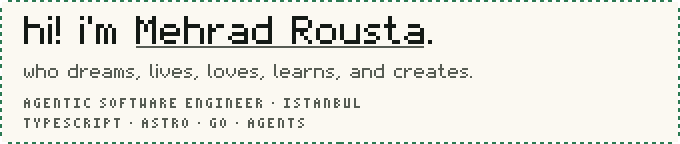
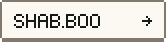
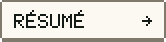
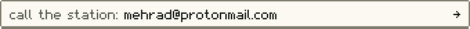
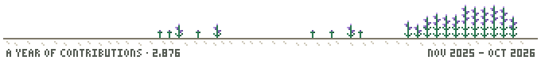

<!-- scene:start -->

<picture><source media="(min-width: 1274px) and (prefers-color-scheme: dark)" srcset="assets/scene-840-night.svg"><source media="(min-width: 1274px)" srcset="assets/scene-840-day.svg"><source media="(min-width: 592px) and (max-width: 761px) and (prefers-color-scheme: dark), (min-width: 880px) and (max-width: 1113px) and (prefers-color-scheme: dark)" srcset="assets/scene-510-night.svg"><source media="(min-width: 592px) and (max-width: 761px), (min-width: 880px) and (max-width: 1113px)" srcset="assets/scene-510-day.svg"><source media="(max-width: 591px) and (prefers-color-scheme: dark), (min-width: 768px) and (max-width: 879px) and (prefers-color-scheme: dark)" srcset="assets/scene-340-night.svg"><source media="(max-width: 591px), (min-width: 768px) and (max-width: 879px)" srcset="assets/scene-340-day.svg"><source media="(prefers-color-scheme: dark)" srcset="assets/scene-night.svg"></picture>

<!-- scene:end -->

<!-- hello:start -->

<picture><source media="(min-width: 1274px) and (prefers-color-scheme: dark)" srcset="assets/card-840-night.svg"><source media="(min-width: 1274px)" srcset="assets/card-840-day.svg"><source media="(min-width: 592px) and (max-width: 761px) and (prefers-color-scheme: dark), (min-width: 880px) and (max-width: 1113px) and (prefers-color-scheme: dark)" srcset="assets/card-510-night.svg"><source media="(min-width: 592px) and (max-width: 761px), (min-width: 880px) and (max-width: 1113px)" srcset="assets/card-510-day.svg"><source media="(max-width: 591px) and (prefers-color-scheme: dark), (min-width: 768px) and (max-width: 879px) and (prefers-color-scheme: dark)" srcset="assets/card-340-night.svg"><source media="(max-width: 591px), (min-width: 768px) and (max-width: 879px)" srcset="assets/card-340-day.svg"><source media="(prefers-color-scheme: dark)" srcset="assets/card-night.svg"></picture>

<a href="https://shab.boo"><picture><source media="(min-width: 1274px) and (prefers-color-scheme: dark)" srcset="assets/link-site-840-night.svg"><source media="(min-width: 1274px)" srcset="assets/link-site-840-day.svg"><source media="(min-width: 592px) and (max-width: 761px) and (prefers-color-scheme: dark), (min-width: 880px) and (max-width: 1113px) and (prefers-color-scheme: dark)" srcset="assets/link-site-510-night.svg"><source media="(min-width: 592px) and (max-width: 761px), (min-width: 880px) and (max-width: 1113px)" srcset="assets/link-site-510-day.svg"><source media="(max-width: 591px) and (prefers-color-scheme: dark), (min-width: 768px) and (max-width: 879px) and (prefers-color-scheme: dark)" srcset="assets/link-site-340-night.svg"><source media="(max-width: 591px), (min-width: 768px) and (max-width: 879px)" srcset="assets/link-site-340-day.svg"><source media="(prefers-color-scheme: dark)" srcset="assets/link-site-night.svg"></picture></a>
<a href="https://blog.shab.boo"><picture><source media="(min-width: 1274px) and (prefers-color-scheme: dark)" srcset="assets/link-blog-840-night.svg"><source media="(min-width: 1274px)" srcset="assets/link-blog-840-day.svg"><source media="(min-width: 592px) and (max-width: 761px) and (prefers-color-scheme: dark), (min-width: 880px) and (max-width: 1113px) and (prefers-color-scheme: dark)" srcset="assets/link-blog-510-night.svg"><source media="(min-width: 592px) and (max-width: 761px), (min-width: 880px) and (max-width: 1113px)" srcset="assets/link-blog-510-day.svg"><source media="(max-width: 591px) and (prefers-color-scheme: dark), (min-width: 768px) and (max-width: 879px) and (prefers-color-scheme: dark)" srcset="assets/link-blog-340-night.svg"><source media="(max-width: 591px), (min-width: 768px) and (max-width: 879px)" srcset="assets/link-blog-340-day.svg"><source media="(prefers-color-scheme: dark)" srcset="assets/link-blog-night.svg"></picture></a>
<a href="https://projects.shab.boo"><picture><source media="(min-width: 1274px) and (prefers-color-scheme: dark)" srcset="assets/link-projects-840-night.svg"><source media="(min-width: 1274px)" srcset="assets/link-projects-840-day.svg"><source media="(min-width: 592px) and (max-width: 761px) and (prefers-color-scheme: dark), (min-width: 880px) and (max-width: 1113px) and (prefers-color-scheme: dark)" srcset="assets/link-projects-510-night.svg"><source media="(min-width: 592px) and (max-width: 761px), (min-width: 880px) and (max-width: 1113px)" srcset="assets/link-projects-510-day.svg"><source media="(max-width: 591px) and (prefers-color-scheme: dark), (min-width: 768px) and (max-width: 879px) and (prefers-color-scheme: dark)" srcset="assets/link-projects-340-night.svg"><source media="(max-width: 591px), (min-width: 768px) and (max-width: 879px)" srcset="assets/link-projects-340-day.svg"><source media="(prefers-color-scheme: dark)" srcset="assets/link-projects-night.svg"></picture></a>
<a href="https://resume.shab.boo"><picture><source media="(min-width: 1274px) and (prefers-color-scheme: dark)" srcset="assets/link-resume-840-night.svg"><source media="(min-width: 1274px)" srcset="assets/link-resume-840-day.svg"><source media="(min-width: 592px) and (max-width: 761px) and (prefers-color-scheme: dark), (min-width: 880px) and (max-width: 1113px) and (prefers-color-scheme: dark)" srcset="assets/link-resume-510-night.svg"><source media="(min-width: 592px) and (max-width: 761px), (min-width: 880px) and (max-width: 1113px)" srcset="assets/link-resume-510-day.svg"><source media="(max-width: 591px) and (prefers-color-scheme: dark), (min-width: 768px) and (max-width: 879px) and (prefers-color-scheme: dark)" srcset="assets/link-resume-340-night.svg"><source media="(max-width: 591px), (min-width: 768px) and (max-width: 879px)" srcset="assets/link-resume-340-day.svg"><source media="(prefers-color-scheme: dark)" srcset="assets/link-resume-night.svg"></picture></a>

<a href="mailto:mehrad@protonmail.com"><picture><source media="(min-width: 1274px) and (prefers-color-scheme: dark)" srcset="assets/call-840-night.svg"><source media="(min-width: 1274px)" srcset="assets/call-840-day.svg"><source media="(min-width: 592px) and (max-width: 761px) and (prefers-color-scheme: dark), (min-width: 880px) and (max-width: 1113px) and (prefers-color-scheme: dark)" srcset="assets/call-510-night.svg"><source media="(min-width: 592px) and (max-width: 761px), (min-width: 880px) and (max-width: 1113px)" srcset="assets/call-510-day.svg"><source media="(max-width: 591px) and (prefers-color-scheme: dark), (min-width: 768px) and (max-width: 879px) and (prefers-color-scheme: dark)" srcset="assets/call-340-night.svg"><source media="(max-width: 591px), (min-width: 768px) and (max-width: 879px)" srcset="assets/call-340-day.svg"><source media="(prefers-color-scheme: dark)" srcset="assets/call-night.svg"></picture></a>

<!-- hello:end -->

<!-- stats:start -->

<picture><source media="(min-width: 1274px) and (prefers-color-scheme: dark)" srcset="assets/stats-840-night.svg"><source media="(min-width: 1274px)" srcset="assets/stats-840-day.svg"><source media="(min-width: 592px) and (max-width: 761px) and (prefers-color-scheme: dark), (min-width: 880px) and (max-width: 1113px) and (prefers-color-scheme: dark)" srcset="assets/stats-510-night.svg"><source media="(min-width: 592px) and (max-width: 761px), (min-width: 880px) and (max-width: 1113px)" srcset="assets/stats-510-day.svg"><source media="(max-width: 591px) and (prefers-color-scheme: dark), (min-width: 768px) and (max-width: 879px) and (prefers-color-scheme: dark)" srcset="assets/stats-340-night.svg"><source media="(max-width: 591px), (min-width: 768px) and (max-width: 879px)" srcset="assets/stats-340-day.svg"><source media="(prefers-color-scheme: dark)" srcset="assets/stats-night.svg"></picture>

<!-- stats:end -->

<!-- log:start -->

<!-- log:end -->

<!-- garden:start -->

<picture><source media="(min-width: 1274px) and (prefers-color-scheme: dark)" srcset="assets/garden-840-night.svg"><source media="(min-width: 1274px)" srcset="assets/garden-840-day.svg"><source media="(min-width: 592px) and (max-width: 761px) and (prefers-color-scheme: dark), (min-width: 880px) and (max-width: 1113px) and (prefers-color-scheme: dark)" srcset="assets/garden-510-night.svg"><source media="(min-width: 592px) and (max-width: 761px), (min-width: 880px) and (max-width: 1113px)" srcset="assets/garden-510-day.svg"><source media="(max-width: 591px) and (prefers-color-scheme: dark), (min-width: 768px) and (max-width: 879px) and (prefers-color-scheme: dark)" srcset="assets/garden-340-night.svg"><source media="(max-width: 591px), (min-width: 768px) and (max-width: 879px)" srcset="assets/garden-340-day.svg"><source media="(prefers-color-scheme: dark)" srcset="assets/garden-night.svg"></picture>

<!-- garden:end -->
